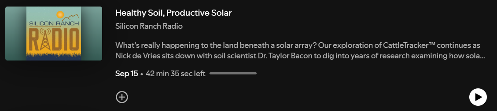
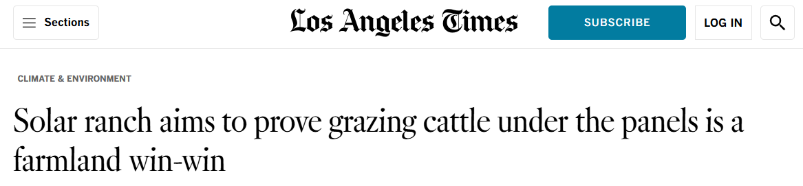

## Recent Media

::: {layout-ncol="1"}
[{width="850"}](https://open.spotify.com/episode/6heRPcEpXTwfGRqvxcyxCk?si=6cbb33d8415e4e05)

[{width="850"}](https://www.latimes.com/environment/story/2026-05-05/solar-ranch-grazing-cattle-under-panels-is-farmland-win-win)

[{width="850"}](https://open.spotify.com/episode/5V4dj6xK46i3aiPSiQ1oOw?si=c85bb7c10d31425d)
:::

## 

## Blog Posts

[More than Megawatts: Envisioning Solar Arrays as Climate-Resilient Ecosystems](https://sustainability.colostate.edu/humannature/more-than-megawatts-envisioning-solar-arrays-as-climate-resilient-ecosystems/) \| Feb 2026

[Panels, Plants, and People: Five Questions in the World of Agrivoltaics Research](https://sustainability.colostate.edu/humannature/five-questions-about-agrivoltaics/) \| Dec 2024

[Stronger national fine particle air pollution standards will provide significant health benefits and reduce disparities](https://globalcleanair.org/environmental-justice/stronger-national-fine-particle-air-pollution-standards-will-provide-significant-health-benefits-and-reduce-disparities/#:~:text=A%20new%20EDF%20report%20finds,communities%20across%20the%20United%20States.) \| Jun 2022

[New analysis: Americans across the country suffered from high ozone pollution levels this summer](https://www.edf.org/aggregator/sources/703) \| Oct 2021

[Driving the electric vehicle transition: auto companies and states step up to lead](https://business.edf.org/insights/driving-the-electric-vehicle-transition-auto-companies-and-states-step-up-to-lead/) \| Apr 2021

[Trump administration decision on soot ignores science, risks American's health](https://blogs.edf.org/climate411/2020/12/07/trump-administration-decision-on-soot-ignores-science-risks-americans-health/?_gl=1*olkjqn*_gcl_au*NjY0NjkwNTc3LjE3MDIwNDkxNTk.*_ga*MjAyNDYzNDM3Mi4xNjk0MTE0Mzc0*_ga_2B3856Y9QW*MTcwMjA0OTE1Ny4xMS4xLjE3MDIwNDk0ODIuNjAuMC4w*_ga_Q5CTTQBJD8*MTcwMjA0OTE1OC4xMS4xLjE3MDIwNDk0ODIuNjAuMC4w) \| Dec 2020

[The Trump administration's air toxics loophole would intensify environmental injustice](https://blogs.edf.org/climate411/2020/05/11/the-trump-administrations-air-toxics-loophole-would-intensify-environmental-injustice/?_gl=1*pd2hr*_gcl_au*NjY0NjkwNTc3LjE3MDIwNDkxNTk.*_ga*MjAyNDYzNDM3Mi4xNjk0MTE0Mzc0*_ga_2B3856Y9QW*MTcwMjA0OTE1Ny4xMS4xLjE3MDIwNDk0ODcuNTUuMC4w*_ga_Q5CTTQBJD8*MTcwMjA0OTE1OC4xMS4xLjE3MDIwNDk0ODcuNTUuMC4w) \| May 2020

[Power company commitments to cut carbon pollution are an important step for our climate and health. Here's what we need next.](https://blogs.edf.org/climate411/2020/05/05/power-company-commitments-to-cut-carbon-pollution-are-an-important-step-for-our-climate-and-health-heres-what-we-need-next/?_gl=1*olkjqn*_gcl_au*NjY0NjkwNTc3LjE3MDIwNDkxNTk.*_ga*MjAyNDYzNDM3Mi4xNjk0MTE0Mzc0*_ga_2B3856Y9QW*MTcwMjA0OTE1Ny4xMS4xLjE3MDIwNDk0ODIuNjAuMC4w*_ga_Q5CTTQBJD8*MTcwMjA0OTE1OC4xMS4xLjE3MDIwNDk0ODIuNjAuMC4w) \| May 2020

[EPA data emphasizes danger of Trump Administration's "air toxics loophole"](https://blogs.edf.org/climate411/2020/02/19/epa-data-emphasizes-danger-of-trump-administrations-air-toxics-loophole/?_gl=1*15q28ho*_gcl_au*NjY0NjkwNTc3LjE3MDIwNDkxNTk.*_ga*MjAyNDYzNDM3Mi4xNjk0MTE0Mzc0*_ga_2B3856Y9QW*MTcwMjA0OTE1Ny4xMS4xLjE3MDIwNDk0OTIuNTAuMC4w*_ga_Q5CTTQBJD8*MTcwMjA0OTE1OC4xMS4xLjE3MDIwNDk0ODcuNTUuMC4w) \| Feb 2020

[The pollution-enabling impacts of the Clean Power Plan "replacement"](https://blogs.edf.org/climate411/2019/10/30/the-pollution-enabling-impacts-of-the-clean-power-plan-replacement/?_gl=1*u0qtup*_gcl_au*NjY0NjkwNTc3LjE3MDIwNDkxNTk.*_ga*MjAyNDYzNDM3Mi4xNjk0MTE0Mzc0*_ga_2B3856Y9QW*MTcwMjA0OTE1Ny4xMS4xLjE3MDIwNDk0OTguNDQuMC4w*_ga_Q5CTTQBJD8*MTcwMjA0OTE1OC4xMS4xLjE3MDIwNDk0OTguNDQuMC4w) \| Oct 2019
